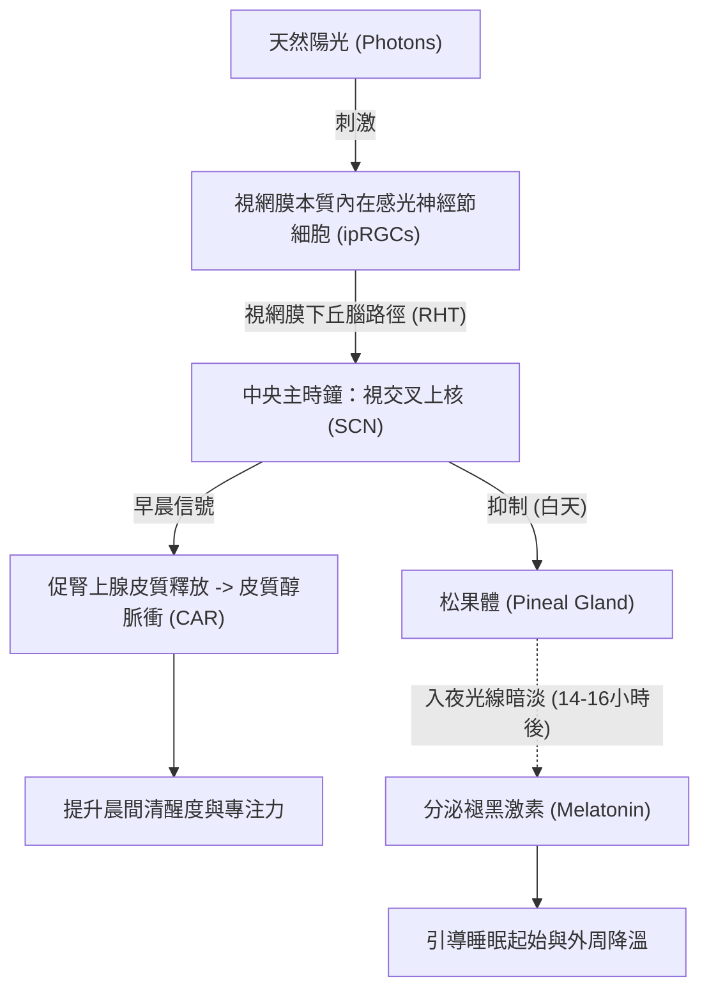

# 晝夜節律（Circadian Rhythm）與光生理調控

## 1. 定義與基本機制
晝夜節律（Circadian Rhythm）是生物體內部以大約 24 小時為週期運行的內源性生物鐘。人體主要的中央主時鐘（Master Clock）位於大腦下丘腦的**視交叉上核（Suprachiasmatic Nucleus, SCN）**。

SCN 透過神經傳導與激素信號協調全身器官的外圍時鐘（Peripheral Clocks），包括肝臟代謝、體溫調控與心血管功能。

## 2. 光照作為最重要的時間校正器（Zeitgeber）
在所有外界環境線索中，光線（特別是波長 460-480 nm 的藍光頻譜）是調控 SCN 最強力的訊號：
- **晨間陽光**：喚醒 SCN，觸發皮質醇甦醒反應（Cortisol Awakening Response, CAR），同時啟動約 14 至 16 小時後的褪黑激素釋放倒數計時。
- **夜間人造光源（LAN）**：即使微弱的頂燈或螢幕光線（>100 Lux），也能抑制松果體分泌褪黑激素，造成節律延遲與入睡困難。

## 3. 雙歷程睡眠模型中的「過程 C」與午後節律波動
睡眠科學著名的**雙歷程模型（Two-Process Model）**指出，睡眠的驅動力由兩個獨立但相互作用的系統決定：
1. **過程 C（Process C - Circadian Process）**：即晝夜節律驅動力，獨立於你醒著的時間長短，根據 24 小時晝夜波動提供警覺度信號。核心調控指標包含：
   - **皮質醇與褪黑激素對衝**：清晨皮質醇達峰（CAR），夜間褪黑激素升起。
   - **核心體溫 24 小時震盪**：下午達峰、入睡後 4 小時降至低谷（約 36.6°C，波動 ~0.5°C）。
   - **餐後低潮（Post-Lunch Dip）**：在 **13:00 至 15:00** 出現短暫的天然警覺度低谷與體溫微降，為人體最佳的 [[interventions/nap-science|午睡修復窗口]]。
2. **過程 S（Process S - Homeostatic Sleep Drive）**：即 [[concepts/sleep-pressure-adenosine|腺苷累積帶來的恆常性睡眠壓力]]。

---
## 相關頁面
- 概念：[[concepts/sleep-pressure-adenosine|睡眠壓力與腺苷（Process S）]]
- 介入：[[interventions/light-exposure|光照管理協議]]
- 介入：[[interventions/bedroom-temperature|溫度調控與臥室微氣候]]
- 介入：[[interventions/nap-science|午睡科學協議（餐後低潮管理）]]
- 補充品：[[supplements/melatonin|褪黑激素評估]]
