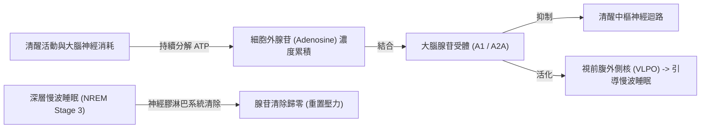
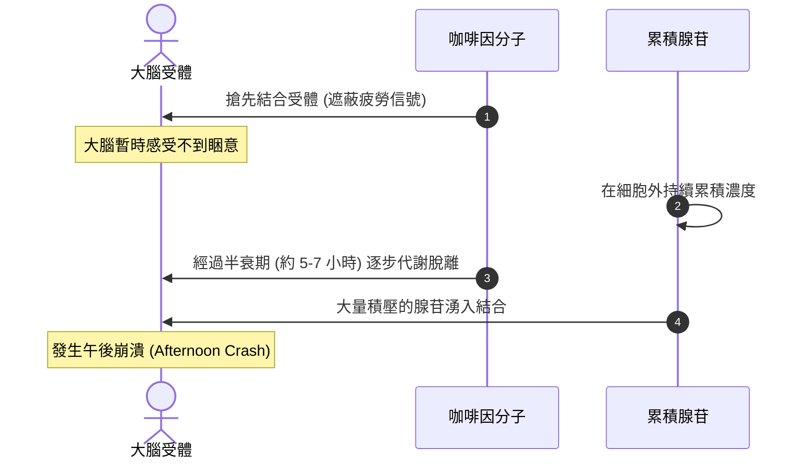

# 睡眠壓力（Process S）與腺苷代謝

## 1. 恆常性睡眠驅力（Homeostatic Sleep Drive）
人體自清晨醒來開始，大腦神經元在消耗能量貨幣 ATP（三磷酸腺苷）的過程中，會持續裂解並在大腦細胞外基質中釋放**腺苷（Adenosine）**副產物。
- 醒著的時間越長，細胞外腺苷濃度就越高。
- 腺苷與大腦中的 A1 及 A2A 受體結合，抑制促進清醒的神經迴路，同時活化視前腹外側核（VLPO）的睡眠促進神經元，產生不可抗拒的「睏意」。

## 2. 雙歷程模型的動態交互作用
- **清晨至午後**：腺苷（Process S）逐漸上升，但此時 Process C（晝夜警覺信號）也在逐步增強，因此人體仍能維持專注。
- **夜間（約 22:00-24:00）**：Process S 達到全日頂峰，而 Process C 的警覺驅動力急遽下降，兩者形成巨大的「睡眠之門（Sleep Gate）」，此時最易進入深沉睡眠。
- **日間小憩對 Process S 的調節**：
  - **10–20 分鐘短午睡**：主要修復警覺度與工作記憶，**不會**將全天累積的腺苷大量洗刷，保留足夠的夜間睡眠驅力。
  - **16:00 後的傍晚長午睡**：會過早重置 Process S，導致夜間入睡時缺乏足夠的睡眠壓力而失眠（詳見 [[interventions/nap-science|午睡科學協議]]）。

## 3. 咖啡因的分子拮抗機制
咖啡因的分子結構與腺苷極為相似，屬於**競爭性拮抗劑（Competitive Antagonist）**。
- 咖啡因會搶先佔據 A1 與 A2A 受體，但**不觸發**受體的睏意信號。
- 這意味著腺苷並未消失，而是在受體外持續累積。當肝臟代謝掉咖啡因後，大量累積的腺苷會猛烈湧入受體，造成嚴重的「午後崩潰（Afternoon Crash）」。

---
## 相關頁面
- 概念：[[concepts/sleep-stages-and-cycles|睡眠結構與四個階段（N3 慢波與腺苷清除）]]
- 概念：[[concepts/circadian-rhythm|晝夜節律（Process C）]]
- 介入：[[interventions/caffeine-and-alcohol|咖啡因代謝與攝取策略（含 2025 臨床數據）]]
- 介入：[[interventions/nap-science|午睡科學協議（Process S 睡眠壓力調節）]]
- 來源：[[sources/sleep321-caffeine-study|睡眠321 咖啡因研究]]
- 來源：[[sources/sleep-foundation-guidelines|Sleep Foundation 咖啡因文獻]]
