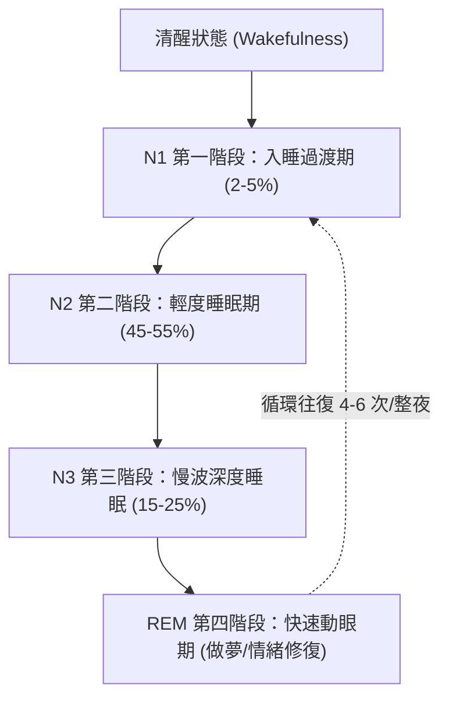
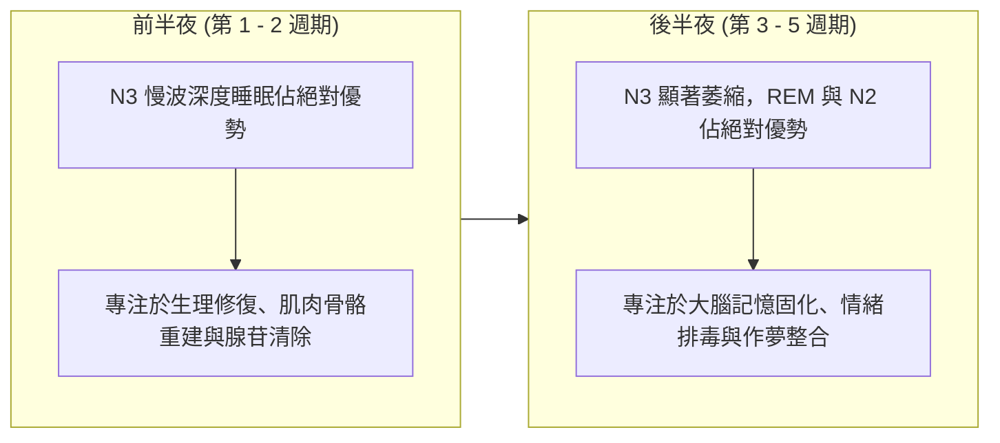

# 睡眠結構：四個階段與週期循環

## 1. 睡眠結構概觀
睡眠絕非大腦「全面關機」，而是一套高度組織化、由腦波節律驅動的週期性動態轉換。現代睡眠醫學將睡眠劃分為兩大狀態、四個階段：
- **非快速動眼期（Non-Rapid Eye Movement, NREM）**：包含第一階段（N1）、第二階段（N2）、第三階段（N3）。
- **快速動眼期（Rapid Eye Movement, REM）**：第四階段。

整夜睡眠由 4 至 6 個睡眠週期（每個週期約 90 至 110 分鐘）銜接而成。

---

## 2. 睡眠四階段詳解與日常可觀察特徵

| 階段別 | 整晚佔比 | 首次出現時機 | 外在觀察表現與行為特徵 | 生理修復與認知功能 |
| :--- | :--- | :--- | :--- | :--- |
| **N1（淺眠過渡）** | 2% – 5% | 剛入睡數分鐘內 | 闔眼但雙眼有微弱緩慢轉動（慢速眼動）；若輕聲呼喚名字極易被喚醒。 | 清醒至睡眠的橋樑，肌肉張力開始放鬆。 |
| **N2（穩態淺眠）** | 45% – 55% | 入睡後 1 – 7 分鐘 | 慢速眼動逐漸消失；輕聲呼喚較不易醒來。整夜佔比最大的基底階段。 | 腦波出現睡眠紡錘波（Sleep Spindles）與 K 複合波，維護睡眠平穩。 |
| **N3（深度慢波睡眠）** | 15% – 25% | **主要集中在前半夜** | 呼吸深沉平穩，極難被喚醒；若強行喚醒會出現嚴重的「睡眠遲緩（Sleep Inertia）」。 | **消除生理疲勞、釋放生長激素、腦部神經膠淋巴系統清除[[concepts/sleep-pressure-adenosine\|腺苷]]的黃金期**。 |
| **REM（快速動眼期）** | 20% – 25% | 入睡後約 60 – 90 分鐘 | 眼球在眼皮下快速左右移動，四肢骨骼肌呈現生理性弛緩（防止夢境動作化）。 | **高達 80% 的生動夢境發生於此**（Dement & Kleitman, 1957）；負責情緒整合、記憶鞏固與創造力連結。 |

---

## 3. 整夜週期架構：前半夜 vs 後半夜的生理分配

一個關鍵的神經生物學特徵是：**深層睡眠（N3）與快速動眼睡眠（REM）在整夜的分配高度不對稱**。

- **前半夜**：人體響應強大的 [[concepts/sleep-pressure-adenosine|Process S（腺苷壓力）]]，大部分深睡（N3）都在前半夜完成。
- **後半夜**：隨體溫與皮質醇逐漸回升，REM 睡眠時長大幅增加。若清晨提早 1-2 小時被吵醒，損失的將主要是脆弱的 REM 睡眠。

---

## 4. 睡眠結構的常見干擾因子與日間小憩機制
- **高劑量咖啡因（如 400mg）**：即使在睡前 12 小時飲用，仍會顯著剝奪 N3 慢波睡眠達 30 分鐘（參見 [[interventions/caffeine-and-alcohol|咖啡因臨床干預]]）。
- **酒精**：初期雖具鎮靜效果，但在後半夜會嚴重破壞 REM 睡眠架構，導致睡眠片段化。
- **日間小憩與睡眠惰性（Sleep Inertia）**：
  - 若午睡時長為 **10–20 分鐘**，大腦僅進入 N1 與 N2 輕眠期，醒來時無任何障礙。
  - 若午睡拉長至 **30–60 分鐘**，大腦強行滑入 N3 慢波深睡；此時若被鬧鐘中途吵醒，會引發持續 30 分鐘以上的認知失調與昏沉，即**「睡眠惰性」**（詳見 [[interventions/nap-science|午睡科學協議]]）。

---
## 相關頁面
- 概念：[[concepts/sleep-pressure-adenosine|睡眠壓力與腺苷代謝（N3 慢波修復）]]
- 介入：[[interventions/caffeine-and-alcohol|咖啡因與酒精代謝干預]]
- 介入：[[interventions/nap-science|午睡科學協議（預防睡眠惰性）]]
- 指南：[[guides/evening-routine-checklist|科學化晚間入睡準備清單]]
