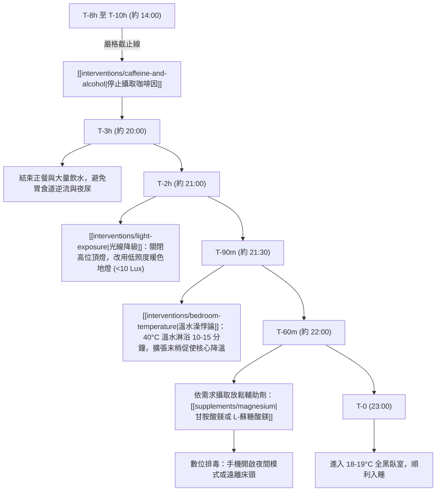

# 科學化晚間入睡準備清單

這份行動清單整合了 [[concepts/circadian-rhythm|晝夜節律（Process C）]] 與 [[concepts/sleep-pressure-adenosine|腺苷睡眠壓力（Process S）]] 的神經生物學原理，將環境與行為優化落實為可執行的就寢時序表。

---

## 1. 晚間入睡倒數時序流程圖

---

## 2. 核心檢核表（Daily Checklist）

### 睡前 8-10 小時（午後時段）
- [ ] **午睡截止線（16:00 嚴禁小憩）**：若午後有短暫疲憊，僅在 13:00-15:00 進行 10-20 分鐘淺眠，16:00 後不補眠以保留 Process S 睡眠壓力。
- [ ] **分級咖啡因截止**：檢視今日飲品標籤（紅標 >200mg 如大杯美式需提前至睡前 12 小時；黃/綠標於睡前 8 小時截止），避免 N3 深睡被削奪。

### 睡前 2-4 小時（黃昏與傍晚）
- [ ] **停止劇烈運動**：睡前 4 小時避免高強度心肺訓練，防止核心體溫持續處於高檔而延誤入睡。
- [ ] **環境微光化**：切換室內照明為暖色、低照度光源，視網膜避開直視高亮度 LED 螢幕。
- [ ] **飲食清淡**：避免高油脂重口味大餐與酒精，防止後半夜 REM 睡眠被破壞。
- [ ] **床鋪邊界設立**：嚴禁在床上使用筆電處理繁雜工作郵件，維持床鋪與「睡眠」的大腦條件反射連結。

### 睡前 60-90 分鐘（身心降溫階段）
- [ ] **臥室恆溫通風**：冷氣或暖氣設定至 18–20°C（65–68°F），搭配微風對流，嚴禁被窩悶熱或低於 15°C 引發肌肉發抖。
- [ ] **寢具人體工學與透氣檢視**：確保枕頭高度自然承托頸椎曲度、床墊透氣散熱不積濕熱。
- [ ] **溫水淋浴/足浴**：利用 40–42°C 水溫促進手腳動靜脈吻合血管（AVA）擴張，出浴後迅速帶走深部核心熱量。
- [ ] **神經舒緩**：補充 140mg 元素鎂（L-蘇糖酸鎂或甘胺酸鎂），進行 5-10 分鐘深慢呼吸或靜態伸展。

---

## 3. 醫療求助紅線提示（來源: [[sources/tendays-melatonin-circadian]]）
若出現以下症狀，切勿僅依賴生活作息調整或保健品，應尋求睡眠醫學專科診斷：
- [ ] 入睡困難或夜間醒來狀況**持續超過數週**。
- [ ] 睡覺時有**劇烈打鼾、半夜嗆醒、呼吸暫停**（高風險為睡眠呼吸中止症）。
- [ ] 白天嚴重嗜睡、情緒失調，或必須依賴酒精/鎮靜藥方能入睡。

---
## 相關頁面
- 核心概念：[[concepts/sleep-stages-and-cycles|睡眠結構與四個階段（N3 與 REM）]]
- 核心概念：[[concepts/sleep-pressure-adenosine|睡眠壓力與腺苷代謝（Process S）]]
- 介入協議：[[interventions/light-exposure|光照管理]]、[[interventions/bedroom-temperature|溫度調控]]、[[interventions/caffeine-and-alcohol|咖啡因與酒精]]、[[interventions/nap-science|午睡科學協議]]
- 補充品分析：[[supplements/magnesium|鎂]]、[[supplements/melatonin|褪黑激素]]
