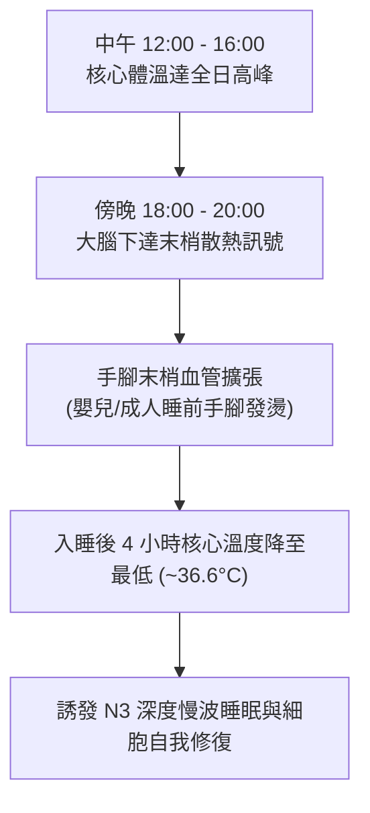

# 溫度調控與臥室微氣候

## 1. 核心體溫與睡眠生理學

### 晝夜體溫震盪規律（24-Hour Diurnal Oscillation）
人體的深層核心體溫（Core Body Temperature）與 [[concepts/circadian-rhythm|晝夜節律]] 緊密相扣：
- **白天**：中午 12 點左右體溫開始攀升，於午後傍晚達到全日最高峰。
- **夜間**：傍晚起大腦下視丘啟動散熱機制，核心體溫穩定下探，在**入睡後約 4 小時降至全日最低點（約 36.6°C）**，全天波動幅度約為 **0.5°C 至 1.0°C**。
- **散熱生理特徵**：為使內部臟器降溫，身體會擴張末梢皮膚微血管以宣洩熱量——這正是**成人剛入睡時感覺體表微熱**，以及**嬰兒睏倦時手腳發燙**的生理原因。

### 荷蘭降溫服研究實證（Dutch Cooling Suit Study）
荷蘭神經科學家進行的臨床實驗發現：透過特殊降溫衣裝使受試者核心體溫下降 1°C，受試者能顯著縮短入睡潛伏期、更順利進入深層慢波睡眠，且半夜微覺醒次數大幅下降；這項生理介入對**經常受淺眠困擾的高齡族群改善最為顯著**。

---

## 2. 溫度控制的兩大極端陷阱：過熱 vs 過冷

> [!WARNING] 臥室環境溫度的雙向地雷
> - **陷阱一：寢具悶熱阻斷散熱**：床墊與棉被透氣性不足會將皮膚排出的濕氣與熱量蓄積在被窩微氣候中，阻斷末梢散熱，使大腦交感神經亢奮而引發失眠。
> - **陷阱二：環境過冷引發肌肉震顫產熱**：體溫並非「越低越好」！冬季若室溫過低（<15°C），身體為了防衛失溫，骨骼肌會自主性緊繃、發抖產熱（Shivering Thermogenesis），肌肉完全無法鬆弛，直接阻斷進入 N3 慢波深睡。

---

## 3. 調節體溫改善睡眠的 5 大科學行動

1. **早晨 10 點前日照（30 分鐘）**：晨光促使清晨體溫順利拉升，並設定 14-16 小時後的褪黑激素分泌倒數計時。
2. **規律運動但避開睡前 4 小時**：運動能提高白天核心體溫並促進血清素分泌；但**睡前 4 小時內嚴禁劇烈高強度運動**，避免睡前體溫居高不下、心率過快。
3. **睡前 60–90 分鐘「溫水澡降溫悖論」**：泡溫熱水（40–42°C）或溫水足浴 10–15 分鐘，刺激末梢動靜脈吻合枝（AVA）擴張，出浴後接觸空氣帶走深層熱量，加速核心降溫。
4. **選用高透氣與涼感散熱寢具**：挑選透氣親膚材質與適度支撐的床墊，維持被窩微環境空氣對流。
5. **空調定溫與空氣循環**：室溫設定在 **18–20°C（65–68°F）**，搭配電風扇微風對流（避免直吹人體），避免熱量於天花板蓄積。

---
## 相關頁面
- 概念：[[concepts/circadian-rhythm|晝夜節律（晝夜體溫震盪軸）]]
- 概念：[[concepts/sleep-stages-and-cycles|睡眠結構（N3 慢波睡眠）]]
- 來源：[[sources/oghome-sleep-temperature|歐瑄寢飾 睡眠體溫研究]]
- 指南：[[guides/evening-routine-checklist|晚間睡前準備清單]]
