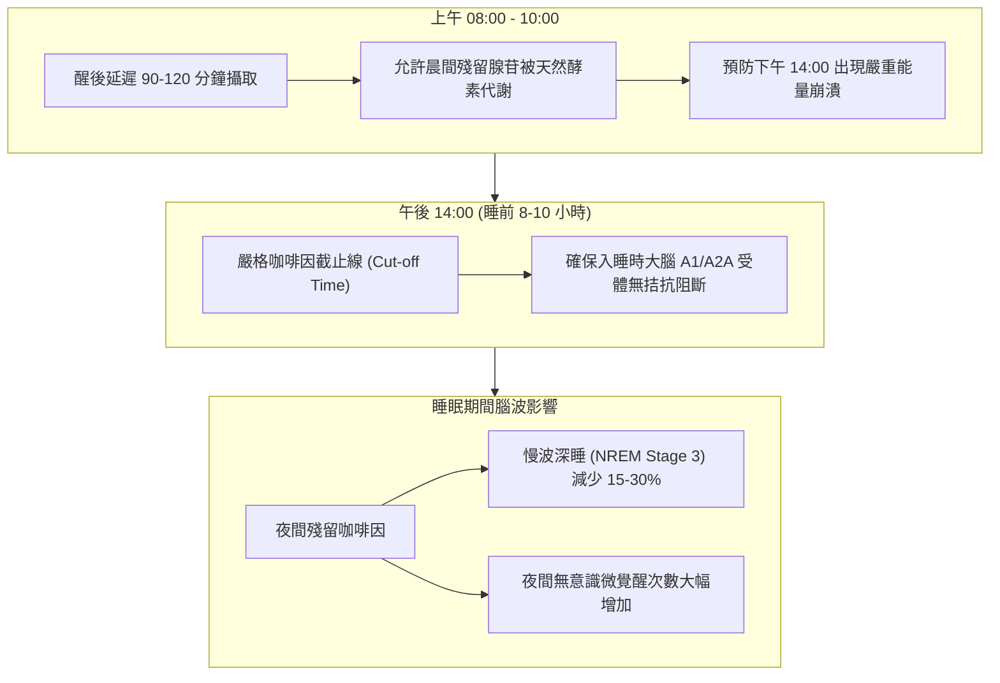
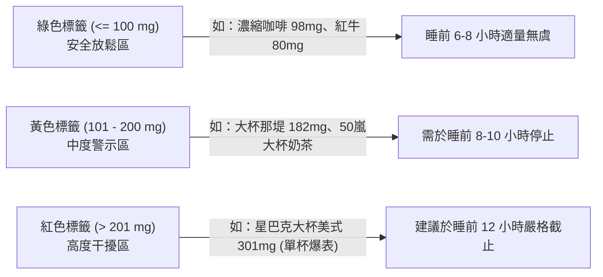

# 咖啡因與酒精代謝干預

## 1. 咖啡因代謝動力學與睡眠結構破壞

### 半衰期與四分之一衰期
- **平均半衰期（Half-life）**：約 5 至 7 小時。
- **四分之一衰期（Quarter-life）**：約 10 至 12 小時。
- **意義**：若下午 2 點飲用含有 200 mg 咖啡因的大杯美式，午夜 12 點體內仍殘留約 50 mg 活性咖啡因（相當於睡前喝了一杯濃郁紅茶）。

> [!WARNING] 主觀感受 vs 客觀腦波監測的盲點落差
> - **常見大眾盲點**：「我睡前喝咖啡照樣能 5 分鐘內睡著，所以咖啡因對我完全沒有負面影響。」
> - **2025 年澳洲隨機交叉臨床試驗（來源: [[sources/sleep321-caffeine-study]]）**：
>   - 即使受試者主觀評估「睡得還可以」，客觀腦波儀（PSG）監測卻證實：**400 mg 咖啡因直接削奪近 30 分鐘的 N3 深度慢波睡眠**，每小時醒來次數增加 1.4 次。
>   - **即使在睡前 12 小時攝取 400 mg**，殘留咖啡因依然能統計顯著地減少深層睡眠與增加夜間覺醒，證實咖啡因的代謝滯留比多數人主觀認知的更漫長。
>   - **劑量依賴性**：100 mg 在睡前 4h/8h/12h 均未對睡眠造成顯著干擾，證實**總劑量是關鍵控制因子**。

---

## 2. 劑量對比表與台灣飲品標示規範

### A. 2025 澳洲 RCT 睡眠破壞數據（400 mg 睡前 4 小時 vs 安慰劑）
| 指標項目 | 影響幅度 | 生理後果 |
| :--- | :--- | :--- |
| **總睡眠時間 (TST)** | 減少 **51 分鐘** | 隔日日間嗜睡、修復不足 |
| **睡眠效率 (Efficiency)** | 下降 **9.5%** | 在床上翻來覆去時間變長 |
| **入睡潛伏期 (Latency)** | 延長 **14 分鐘** | 延遲進入初睡狀態 |
| **進入穩定睡眠時間** | 增加 **25 分鐘** | 前期淺眠（N1/N2）比例虛增 |
| **深層睡眠時間 (N3)** | **減少近 30 分鐘 (-4.8%)** | **體能修復受阻、腺苷無法完全清除** |

### B. 台灣衛福部紅黃綠標籤制度與常見飲品含量
台灣現行法規要求現煮咖啡與飲品標示咖啡因色標，日常可作為精準控量的依據：

- **官方每日建議上限**：
  - **成人**：每日控制在 **300 毫克**以內（一杯星巴克大杯美式即達上限 301 mg）。
  - **青少年（12–18 歲）**：控制在 **100 毫克**以下。
  - **孕婦與 12 歲以下孩童**：應避免攝取。
- **長期過量副作用**：長期過量咖啡因會降低大腦對感知與精細動作的神經微調能力，並拉低工作記憶運算效率。

---

## 3. 酒精的鎮靜假象與 REM 睡眠剝奪
- **酒精非助眠劑，而是鎮靜劑（Sedative）**：酒精透過增強 GABA 能系統抑制大腦新皮質，帶來「斷電（Sedation）」而非生理性入睡。
- **代謝副產物乙醛**：酒精在體內代謝產生乙醛，會在後半夜引發交感神經反彈（Sympathetic Rebound），導致後半夜頻繁驚醒。
- **毀滅性阻斷 REM 睡眠**：酒精是目前已知最強大的快速動眼期（REM）抑制劑之一，長期睡前飲酒會嚴重損害情緒修復與記憶鞏固。

---

## 4. 落地執行原則
1. **晨間延遲攝取**：起床後等待 90-120 分鐘再喝第一杯含咖啡因飲品，允許腺苷自然消散。
2. **劑量分級截止線**：
   - 攝取 **紅標飲品（>200mg，如大杯美式）**：睡前 **10 至 12 小時**即應停用。
   - 攝取 **黃/綠標飲品（<200mg，如那堤、茶飲）**：睡前 **8 小時**停用。
3. **每日總量控管**：成人每日不超過 300 毫克上限。
4. **基因個體差異考量**：肝臟 CYP1A2 酵素代謝較慢者（Slow Metabolizers），截止線應一律提前至睡前 12-14 小時。

---
## 相關頁面
- 概念：[[concepts/sleep-stages-and-cycles|睡眠結構與四個階段（N3 慢波剝奪）]]
- 概念：[[concepts/sleep-pressure-adenosine|腺苷與睡眠壓力]]
- 來源：[[sources/sleep321-caffeine-study|睡眠321 咖啡因研究]]
- 來源：[[sources/sleep-foundation-guidelines|AASM 咖啡因指引]]
- 來源：[[sources/huberman-sleep-toolkit|Huberman 睡眠工具箱]]
