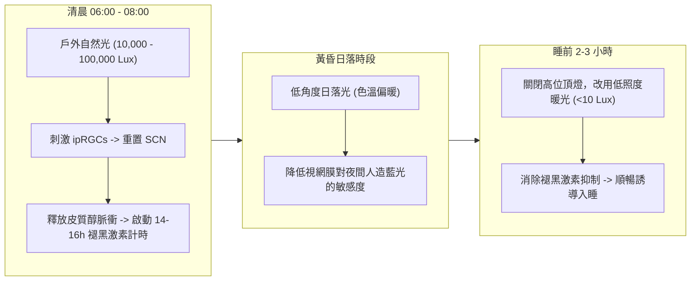

# 光照管理協議（Light Viewing Protocol）

## 1. 科學原理摘要
光線是校準大腦 SCN 主時鐘最強大的環境因素（Zeitgeber）。透過策略性安排一整天的光照接觸時機與光譜強度，可以直接調控褪黑激素與皮質醇的分泌時程。

## 2. 具體可落地的行動指南

### A. 晨間戶外光照（Morning Sunlight）
- **時間點**：醒來後 30 至 60 分鐘內。
- **時長要求**：
  - 晴天無雲：戶外直視光照方向（非直視太陽本體）**5 至 10 分鐘**。
  - 陰天/多雲：戶外 **15 至 20 分鐘**。
  - 嚴重陰雨天：**20 至 30 分鐘**。
- **注意事項**：**不可隔著窗戶或汽車擋風玻璃**（玻璃會濾除關鍵波長並大幅衰減照度；室內窗邊通常僅約 500-1000 Lux，戶外陰天亦有 10,000 Lux 以上）。不可戴太陽眼鏡（近視眼鏡與隱形眼鏡無妨）。

### B. 夜間光線控制（Nighttime Darkness）
- **21:00 後**：切換臥室與客廳光源為桌燈、地燈或踢腳線燈（SCN 神經元主要接收來自視網膜下半部、即上方射入的光線，因此低位光源干擾最小）。
- **睡眠期間**：臥室光照應保持在 **< 5 Lux**（全黑環境最佳）。使用遮光窗簾或高品質眼罩。
- **夜間如廁**：避免開啟刺眼浴室頂燈，建議使用極弱紅光小夜燈（紅光波長對 ipRGCs 刺激最小）。

---
## 相關頁面
- 概念：[[concepts/circadian-rhythm|晝夜節律（Circadian Rhythm）]]
- 指南：[[guides/evening-routine-checklist|晚間睡前準備清單]]
