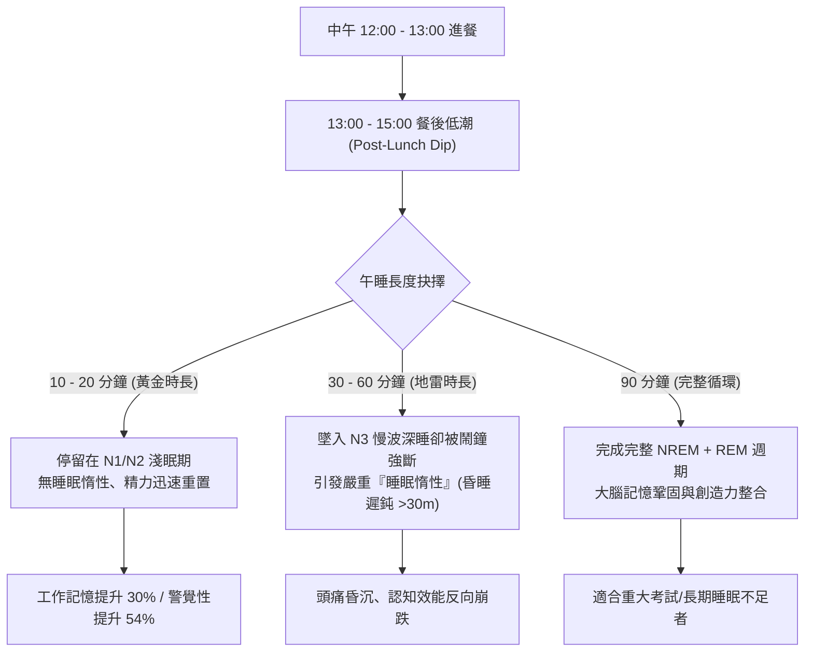

# 午睡科學協議：黃金時長、餐後低潮與睡眠惰性預防

## 1. 生理機制：為什麼午後會出現天然睏意？
人體在**下午 13:00 至 15:00** 會自然經歷一段警覺度下降與睏倦感，稱為**餐後低潮（Post-Lunch Dip）**。
- **雙重驅動機制**：
  1. **晝夜節律（Process C）自然波動**：大腦中央生物鐘在此區間內存在微弱的生理警覺性低谷，且此時核心體溫出現短暫微降。
  2. **消化代謝協同**：午餐攝取碳水化合物促進胰島素釋放，促使色胺酸進入大腦轉化為血清素，加劇放鬆感。

---

## 2. 臨床研究佐證
- **NASA 飛行員研究**：美國太空總署針對軍事飛行員的研究顯示，平均 **26 分鐘的小憩（Power Nap）**，能使飛行員的整體作業任務表現提升 **34%**，生理警覺度大幅提升 **54%**。
- **認知記憶研究**：20 分鐘以內的淺眠午睡，可使下午的工作記憶容量與新資訊學習效率提高 **30% 以上**。

---

## 3. 午睡時長矩陣與睡眠惰性（Sleep Inertia）解析

> [!WARNING] 睡眠惰性地雷區：為什麼睡 40 分鐘反而比不睡更累？
> - 當小憩超過 25 分鐘，大腦會依序滑入 **[[concepts/sleep-stages-and-cycles|N3 慢波深度睡眠]]**。此時腦波轉為高振幅、低頻率的 Delta 波，大腦新皮質血液灌流量驟降。
> - 若在此時被鬧鐘強行喚醒，大腦皮質無法瞬間建立清醒的神經連結，會產生持續 30 至 60 分鐘的認知遲鈍、定向障礙與煩躁感，稱為**「睡眠惰性（Sleep Inertia）」**。

| 午睡時長分類 | 涵蓋之睡眠階段 | 醒來生理狀態 | 建議度 | 適用情境 |
| :--- | :--- | :--- | :--- | :--- |
| **微憩（Micro-nap）** 10 – 15 分鐘 | N1 淺眠過渡 | 即刻清醒，掃除眼部與神經疲憊 | ★★★★★ | 辦公室高壓、會議空檔 |
| **能量小憩（Power nap）** 20 – 25 分鐘 | N1 + N2 穩定淺眠 | 精力完全復原，認知專注度達頂峰 | ★★★★★ | **常規最佳標準時長** |
| **危險地雷區** 30 – 60 分鐘 | **半途陷入 N3 慢波** | **嚴重睡眠惰性、頭痛、全身乏力** | ☆☆☆☆☆ | **極力避免** |
| **週期睡眠（Full Cycle）** 90 分鐘 | N1 → N2 → N3 → REM | 自然從 REM 淺眠醒來，思維清晰 | ★★★★☆ | 週末補眠、創作前夕 |

---

## 4. 落地實踐黃金法則
1. **黃金時間窗口**：於 **13:00 至 15:00** 之間就寢（午餐後約 1 小時）。
2. **嚴格傍晚截止線（16:00 Cut-off）**：**超過下午 16:00 嚴禁午睡**！傍晚午睡會大幅消耗人體積累的 [[concepts/sleep-pressure-adenosine|Process S（腺苷睡眠壓力）]]，導致夜間入睡困難與晝夜節律後移。
3. **鬧鐘設定技巧**：考量一般人約需 5-10 分鐘入睡，建議鬧鐘定在 **25 至 30 分鐘**，確保實際睡眠時間落在 15-20 分鐘。
4. **環境支援**：若辦公室無法平躺，使用眼罩、抗噪耳塞並坐在椅上放鬆微仰閉目 10 分鐘，依然具備 70% 的神經疲勞重置效益。

---
## 相關頁面
- 概念：[[concepts/sleep-stages-and-cycles|睡眠結構：四個階段與週期循環]]
- 概念：[[concepts/sleep-pressure-adenosine|睡眠壓力與腺苷代謝（Process S）]]
- 概念：[[concepts/circadian-rhythm|晝夜節律（餐後低潮機制）]]
- 指南：[[guides/evening-routine-checklist|晚間睡前準備清單]]
