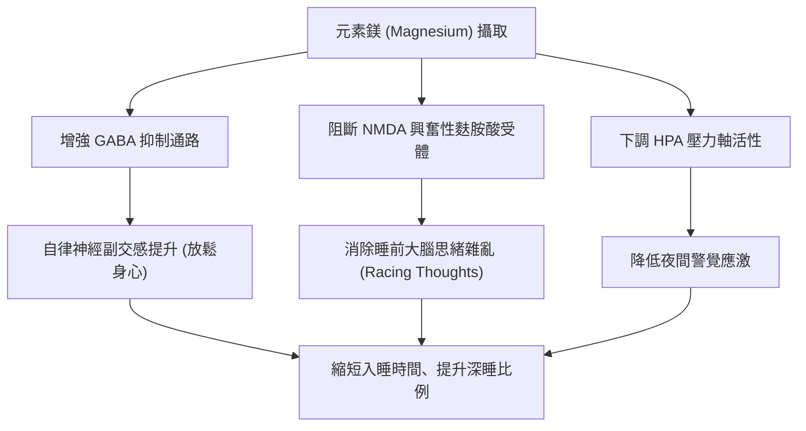

# 鎂（Magnesium）在睡眠與神經放鬆中的機制與形式評估

## 1. 生理作用機制
鎂離子（Mg²⁺）是人體超過 300 種酵素反應的輔助因子，在神經傳導平衡與睡眠調控中扮演核心閘門角色：
1. **GABA 受體激發**：鎂能結合並增強抑制性神經傳導物質 $\gamma$-胺基丁酸（GABA）受體的功能，平息大腦皮質過度放電。
2. **NMDA 受體阻斷（Voltage-dependent Block）**：阻斷興奮性麩胺酸（Glutamate）受體，防止神經元處於過度興奮的興奮性毒性或緊繃狀態。
3. **皮質醇調節**：研究指出鎂可下調下丘腦-垂體-腎上腺軸（HPA 軸）活性，降低夜間皮質醇波動。

---

## 2. 不同螯合型態的實證效益比較

並非所有鎂劑型都能有效輔助睡眠，型態決定了吸收率與生物利用度：

| 鎂型態（Form） | 穿透血腦屏障（BBB）能力 | 腸道耐受性 / 腹瀉風險 | 臨床實證與睡眠應用特點 |
| :--- | :--- | :--- | :--- |
| **L-蘇糖酸鎂 (Magnesium L-Threonate)** | **極高**（專利 Magtein 研究顯示顯著提升腦脊液鎂濃度） | 優良（極少腹瀉） | 最適合大腦認知抗衰、減少睡前思緒飛躍，常規劑量 140-145 mg 元素鎂。 |
| **甘胺酸鎂 (Magnesium Bisglycinate)** | 中等（結合甘胺酸自身即具中樞抑制與末梢散熱效益） | 優良（高吸收率、溫和） | 性價比最高，甘胺酸協同作用能加速核心體溫下降與肌肉放鬆。劑量約 200-400 mg。 |
| **檸檬酸鎂 (Magnesium Citrate)** | 低 | 具滲透性通便效果（易腹瀉） | 主要用於緩解便秘，不推薦作為純睡眠改善劑。 |
| **氧化鎂 (Magnesium Oxide)** | 極低（生體可用率 < 4%） | 嚴重腹瀉傾向 | 吸收極差，多數隨糞便排出，無顯著神經效益。 |

---

## 3. 實踐與注意事項
- **服用時機**：睡前 30 至 60 分鐘。
- **禁忌群體**：嚴重腎功能不全者（難以代謝過量鎂，有高血鎂風險）、重症肌無力患者。
- **副作用監控**：若早晨出現稀便或腹瀉，代表超過腸道耐受閾值，應減量或更換為甘胺酸螯合型。

---
## 相關頁面
- 介入：[[interventions/bedroom-temperature|溫度調控（甘胺酸降溫效應）]]
- 補充品：[[supplements/melatonin|褪黑激素評估]]
- 來源：[[sources/huberman-sleep-toolkit|Huberman 睡眠補充劑配方]]
