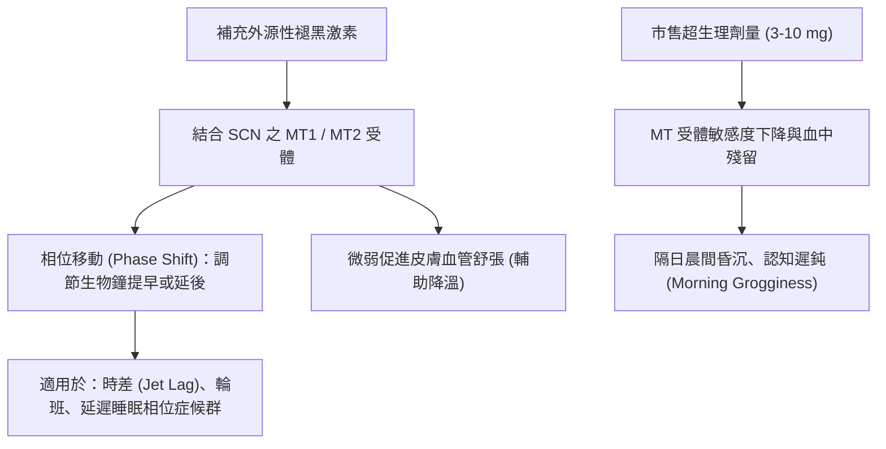
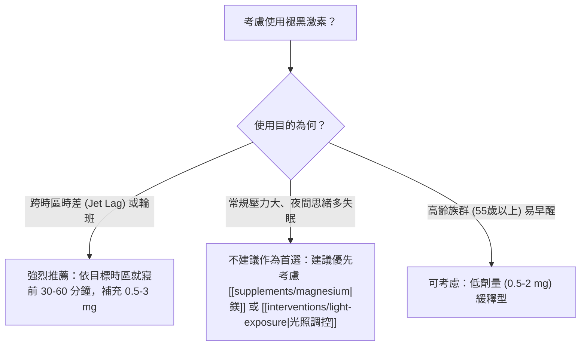

# 褪黑激素（Melatonin）的臨床實證、劑量迷思與爭端

## 1. 生理本質：節律調節劑（Chronobiotic）而非安眠藥（Hypnotic）
褪黑激素由松果體在夜間暗信號驅動下合成分泌。它在體內的生理角色是**告訴身體「現在是夜晚」的計時信號**，本身並不像安眠藥（如苯二氮平類）具有強烈的強迫性中樞鎮靜效果。

---

## 2. 核心爭議與觀點衝突

> [!WARNING] 觀點爭端：慢性失眠的一線輔助 vs. 不推薦常態使用
> - **神經科學實踐觀點（來源: [[sources/huberman-sleep-toolkit]]）**：
>   - 強烈不建議健康青壯年常規每天補充市售褪黑激素（尤其常見的 3mg - 10mg）。
>   - 主張市售劑量遠高於生理濃度數十倍，可能抑制自體松果體調節，並干擾荷爾蒙平衡；且易引發第二天的認知疲勞或生動惡夢。
> - **睡眠醫學臨床指引（來源: [[sources/sleep-foundation-guidelines|AASM 指南]]）**：
>   - 褪黑激素**並非**原發性慢性失眠（Chronic Insomnia）的一線治療（第一線療法為 CBT-I 失眠認知行為治療）。
>   - 但對於 **55 歲以上族群**，因松果體鈣化導致內源性分泌顯著減少，臨床上 1-2 mg 緩釋型褪黑激素在多項 RCT 中證實可顯著提升睡眠維持率且耐受性良好。
>   - **劑量迷思**：多項研究指出，最佳生理有效劑量其實落在 **0.3 mg 至 1 mg**，過量並不會提升睡眠深度，反而增加副作用。

---

## 3. 實用選用決策樹

---

## 4. 台灣法規管制屬性與高風險族群警訊

> [!CAUTION] 台灣法規管制與用藥安全提醒（來源: [[sources/tendays-melatonin-circadian]]）
> - **法規屬性**：在部分歐美國家常作為一般膳食補充品，但在**台灣，標示含褪黑激素（Melatonin）的產品被主管機關列為「藥品」列管**，並非合法自行販售或任意購買的保健食品，擅自網路代購或販售有觸法風險。
> - **非萬能解方**：若睡眠問題源自焦慮壓力、慢性疼痛、藥物副作用或**睡眠呼吸中止症（Sleep Apnea）**，補充褪黑激素完全無效，切勿延誤正規就醫。
> - **高風險不建議自行使用族群**：
>   - **兒童與青少年**：可能干擾性腺發育軸與內源荷爾蒙分泌。
>   - **孕婦與哺乳婦女**：缺乏足夠安全性臨床數據。
>   - **自體免疫疾病患者**（如紅斑性狼瘡、類風濕關節炎）：褪黑激素具免疫刺激調節作用，可能誘發病情波動。
>   - **癲癇與肝腎疾病患者**：代謝障礙可能引發體內蓄積中毒。

---

## 5. 何時必須尋求醫療介入？
出現以下警訊時，代表已超出自我營養品或生活型態介入範圍，應諮詢睡眠專科醫師：
1. 入睡困難或夜間頻繁驚醒**持續數週以上**。
2. 白天嚴重嗜睡、認知記憶衰退或情緒劇烈波動。
3. 出現嚴重打鼾、睡眠中呼吸暫停、半夜嗆醒驚悸。
4. 必須依賴酒精或強效鎮靜藥物方能入睡。

---
## 相關頁面
- 概念：[[concepts/circadian-rhythm|晝夜節律（SCN 與松果體）]]
- 補充品：[[supplements/magnesium|鎂元素與神經放鬆]]
- 來源：[[sources/sleep-foundation-guidelines|AASM 臨床指南]]
- 來源：[[sources/tendays-melatonin-circadian|Tendays 睡眠專欄]]
